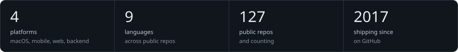
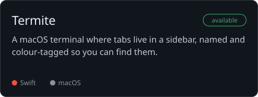
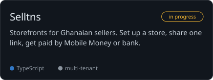
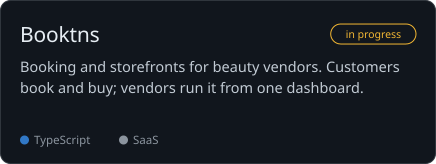
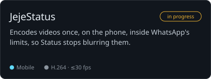
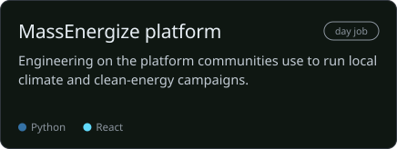

<!-- Generated by scripts/build.py from profile.yml and README.template.md. Edit those, not this file. -->

  

## The multiplier

AI only multiplies what you already know. I've built these systems by hand across four platforms, so I can tell good output from plausible output and fix the difference myself. The engineering decisions stay with me. Agents take the volume.

<table>
<tr><th align="left" width="50%">What I own</th><th align="left" width="50%">What AI speeds up</th></tr>
<tr><td valign="top">
System architecture and data models 
Auth, security and payments (Mobile Money, bank) 
Performance work, like on-device video encoding 
Debugging the problems agents can't see 
Review of every diff before it merges
</td><td valign="top">
Scaffolding and boilerplate 
Test coverage 
Refactors that touch dozens of files 
Porting a feature across platforms 
Docs and first drafts of specs
</td></tr>
</table>

**How a project runs:** <code>SPEC.md</code> → <code>architecture</code> → <code>CLAUDE.md</code> → <code>parallel agents</code> → <code>review + ship</code> 
**Toolkit:** Claude Code · Cursor · Cline · MCP · LLM APIs

## Selected work

### Biibisoft studio
Products I own and build independently.

### Professional · MassEnergize
Work done as part of my role.

## Stack

| Layer | Tools |
| :-- | :-- |
| **mac** | Swift · AppKit · SwiftUI |
| **mobile** | React Native · Expo · Java / Android |
| **web** | TypeScript · React · Next.js · Tailwind |
| **backend** | Python / Django · FastAPI · Node / NestJS · PHP / Laravel · Firebase |
| **ai + data** | pgvector · embeddings · RAG · LLM APIs |
| **infra** | AWS · Docker · WordPress multisite |

<b>From the vault</b>: older things I'm still proud of

- **[Fut Plaque](https://fut-plaque.vercel.app)**: make memories of your best FUT pulls. `JS + Python`
- **[Perfect Attendance](https://github.com/frimpongopoku/perfect-attendance)**: a bot that attends your Google Meet classes for you. `Python`
- **[100k](https://github.com/frimpongopoku/100k)**: map and scan trees toward a 100,000-tree planting goal. `Laravel + MySQL`

 

Built in Accra, Ghana · open to interesting problems

